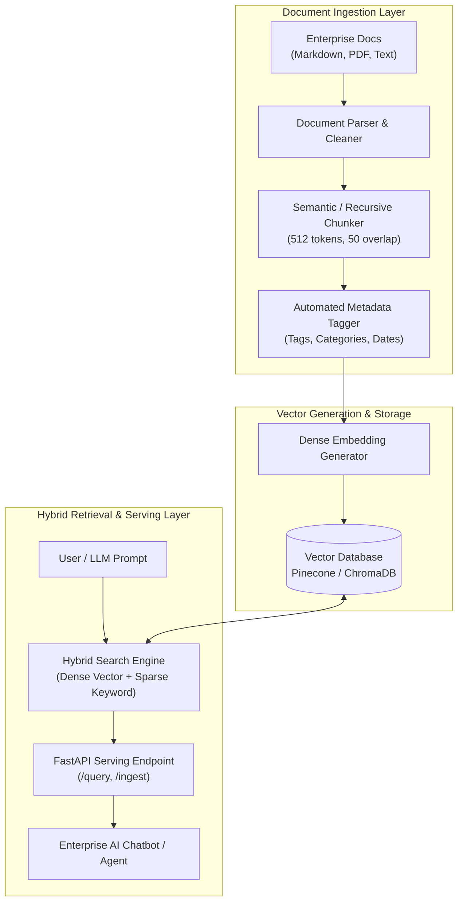

# Enterprise LLM Knowledge Base RAG Data Pipeline

[](https://github.com/SoniaBlake-DataEng/llm-rag-data-pipeline/actions)
[](https://opensource.org/licenses/MIT)
[](https://www.python.org/downloads/)
[](https://fastapi.tiangolo.com/)
[](https://www.pinecone.io/)

> **End-to-end data ingestion and embedding pipeline transforming unstructured enterprise documents into indexed vector representations with automated metadata extraction, semantic chunking, and hybrid retrieval for LLM chatbots.**

---

## 🏗️ Architecture & Data Ingestion Pipeline



---

## 🚀 Key Technical Highlights

* **Intelligent Semantic Chunking**: Respects paragraph and sentence boundaries to avoid splitting critical context mid-sentence.
* **Rich Metadata Tagging**: Extracts author, document domain, regulatory classification, and chunk sequence indices to enable granular query filtering.
* **Hybrid Search Engine**: Fuses dense cosine similarity vector search with sparse keyword scoring to maximize retrieval recall on specialized terminology.
* **Production-Grade Serving API**: Built with FastAPI and Pydantic validation, offering sub-50ms query latency.

---

## 📂 Project Structure

```
llm-rag-data-pipeline/
├── .github/workflows/ci.yml       # CI workflow for linting & tests
├── docs/
│   └── architecture.md            # RAG pipeline design & chunking benchmarks
├── sample_docs/
│   ├── enterprise_governance.md   # Sample data platform governance doc
│   └── compliance_guide.md        # Sample HIPAA / SOC2 guide
├── src/
│   ├── __init__.py
│   ├── config.py                  # Pipeline configurations
│   ├── api/
│   │   └── app.py                 # FastAPI retrieval & query service
│   ├── ingestion/
│   │   ├── chunker.py             # Semantic document chunker
│   │   ├── metadata_tagger.py     # Metadata extractor
│   │   └── vector_indexer.py      # Embedding & index upsert engine
│   └── retrieval/
│       └── hybrid_search.py       # Dense + sparse retrieval engine
├── tests/
│   └── test_rag_pipeline.py       # Unit tests
├── scripts/
│   ├── setup_github.bat           # 1-click Windows push script
│   └── push_to_github.ps1         # PowerShell deployment script
├── docker-compose.yml             # Local service orchestration
├── requirements.txt               # Dependencies
└── .gitignore
```

---

## ⚡ Quickstart

```bash
# 1. Clone repository
git clone https://github.com/SoniaBlake-DataEng/llm-rag-data-pipeline.git
cd llm-rag-data-pipeline

# 2. Setup Virtual Environment
python -m venv venv
.\venv\Scripts\activate  # On Linux: source venv/bin/activate
pip install -r requirements.txt

# 3. Ingest documents into Vector Index
python -m src.ingestion.vector_indexer

# 4. Run tests
pytest tests/ -v

# 5. Start API Server
uvicorn src.api.app:app --reload --port 8000
```

---

## 📜 License
MIT License.
